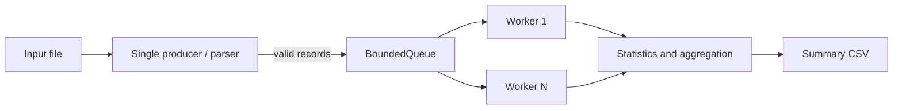

# Architecture

## Pipeline and ownership

`LogProcessor::process_file` owns the input stream, bounded queue, statistics, and worker
threads for one run. The calling thread is the sole producer: it reads each line, updates
input classification counters, parses it, timestamps valid records immediately before
queue submission, and pushes them. Workers own no shared record state after popping;
each receives a moved `LogRecord`.

The queue has a fixed capacity. A producer waits until a slot is free or the queue closes.
A consumer waits until a record is available or the queue closes. Both condition-variable
waits use predicates, so spurious wakeups do not change correctness. The queue mutex
protects its closed flag and deque. Notifications occur after releasing the mutex.

`close()` is idempotent. It prevents future pushes and wakes all blocked producers and
consumers. A consumer continues popping existing records after close; it returns false
only when the queue is both closed and empty. The producer closes the queue after EOF or a
read error; `process_file` then joins all workers, ensuring queued records drain on normal
shutdown. A worker exception records the first exception and closes the queue to unblock
the producer. After joining, the exception is rethrown to the caller.

## Synchronization and statistics

`Statistics` uses one mutex to protect input counters, severity and component maps, the
checksum, and latency samples. This simple lock ownership is easy to reason about and
correct for this teaching application; it may become a contention point at high worker
counts. Parsing is producer-local, and each worker's current record is thread-local.
The worker exception pointer has a separate mutex. No atomic is needed for shared state.

The checksum is the unsigned 64-bit sum (wrapping modulo 2^64) of FNV-1a hashes of
canonical `timestamp|level|component|message` records. It is order-independent and
duplicate-sensitive; it is a useful consistency check, not a cryptographic integrity
guarantee.

Latency starts immediately before queue submission and ends after the worker's aggregate
update is complete. It therefore includes producer backpressure and queue waiting as well
as dispatch and aggregation time; it is not isolated CPU processing time.

## Errors and trade-offs

Malformed input is counted and skipped. Blank or whitespace-only lines are counted
separately and do not count as malformed. Input open/read errors, output errors, invalid
options, and worker failures are surfaced to stderr with a non-zero exit status. The
processor rethrows errors after joining workers.

The single producer, one aggregation mutex, memory retained for every latency sample, and
per-item synchronization may limit throughput. More workers can increase scheduling and
contention costs and are not guaranteed to improve performance. Sharding aggregation or
sampling latency could reduce overhead, but those changes are not implemented.
